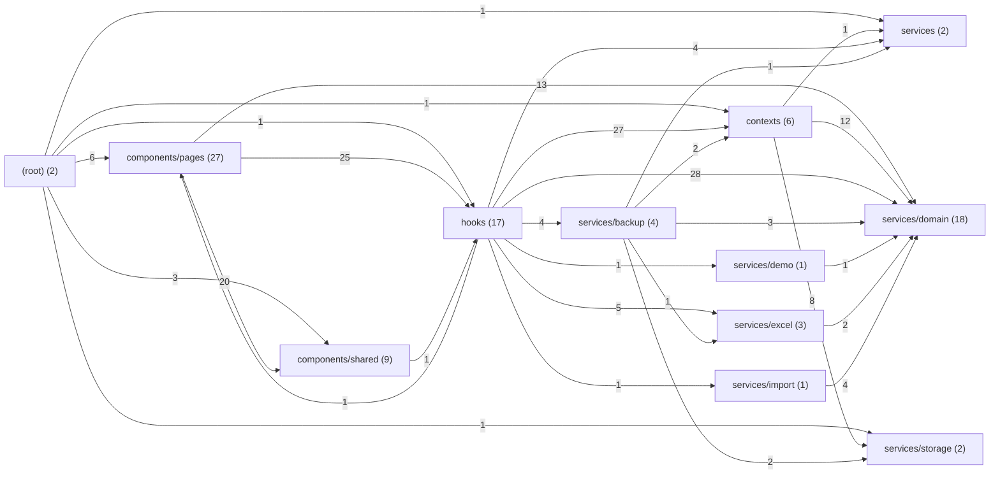

# 모듈 의존 그래프 (src)

파일 92개 · import 233건 (테스트 파일·타입 전용 import 제외). 화살표는 "A가 B를 import".

## 가장 많이 import되는 파일 Top 10

| 파일 | 피참조 수 |
|---|---|
| services/domain/amount.ts | 15 |
| services/domain/dates.ts | 13 |
| contexts/MemberContext.tsx | 10 |
| components/shared/Modal.tsx | 9 |
| services/domain/positions.ts | 9 |
| contexts/DonationContext.tsx | 8 |
| contexts/OfferingTypeContext.tsx | 8 |
| services/domain/ids.ts | 8 |
| services/storage/storageService.ts | 7 |
| hooks/useReports.ts | 6 |

## 서로 import하는 파일 쌍(순환)

없음
